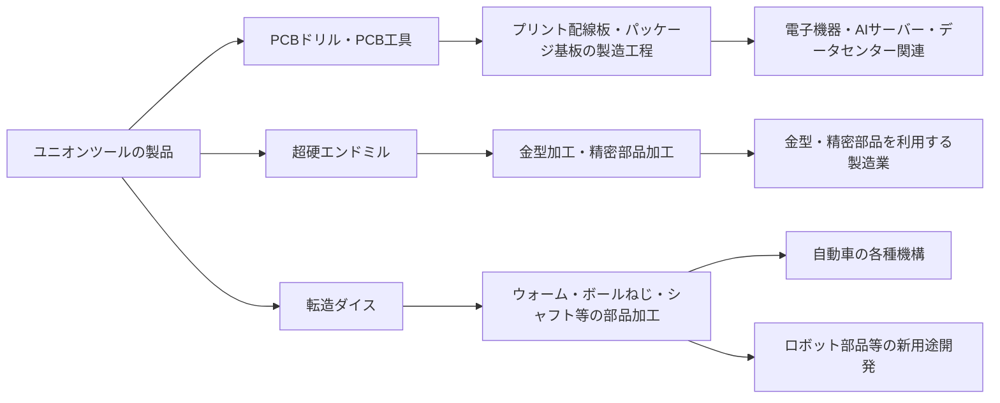

# ユニオンツール株式会社：事業内容・顧客・関連事項の抽出

出典：[有価証券報告書（00.pdf）](00.pdf)／[全文Markdown（00.md）](00.md)  
対象：第65期（2025年1月1日～2025年12月31日）、2026年3月24日提出。

本文は報告書の関連記載を項目別に抜き出し、要約・整理したものです。「当社」はユニオンツール株式会社を指し、グループの情報はその旨を記載しています。ページ番号はPDFのページ番号です。将来の方針・計画・市場見通しは報告書作成時点の記載です。

## 1. 事業の概要

- 当社グループは産業用切削工具を主力とし、PCB工具（主にプリント基板用ドリル）の製造・販売を中心に事業を展開している。
- 主な製品は、プリント配線板用超硬ドリル（PCBドリル）、超硬エンドミル、転造ダイス、測定機器など。
- グループ売上高の約7割をPCBドリルが占める。対象市場が異なる超硬エンドミルや転造ダイス製品の拡大にも注力している。
- 日本・アジア・北米・欧州の4地域で事業を展開している。

出典：p.5「事業の内容」、p.11「事業等のリスク」。

## 2. 製品・用途・顧客の要求

| 製品・分野 | 報告書に記載された用途・市場 | 顧客要求・開発の方向性 |
| --- | --- | --- |
| PCBドリル・PCB工具 | プリント配線板の穴あけ。半導体パッケージ基板、高多層基板、AIサーバー・データセンター向け基板など | 高品質・高密度化への対応、寿命の延長、高アスペクト比加工、高難易度の加工への対応 |
| ULFコートドリル | FC-BGAパッケージ基板、高多層マザーボード向け | 次世代のマルチレイヤーコア技術、厚板化、クオーツガラスクロスへの対応 |
| 小径ルーター | 内層コアへの部品内蔵用キャビティ加工 | 専用工具の開発 |
| 超硬エンドミル | 超硬合金・硬脆材・鋼材の加工、金型加工、精密部品加工 | 長寿命、高品質、顧客のコストダウン、高精度加工・鏡面仕上げ |
| 転造ダイス | 自動車のパワーウインドウ・パワーシート・ワイパー用ウォーム、衝突被害軽減ブレーキ・電動パワーステアリング用ボールねじなど | 耐久性、精密な形状精度、自動車シャフト部品の軽量化への対応 |
| スプライン・セレーション用ダイス | 中空ワークの転造加工 | 内径変形・楕円形成の抑制、累積ピッチ誤差の改善。特許取得済み |
| 測定機器 | その他製品として記載 | この抽出対象の記載では具体的な用途・顧客名は示されていない |

出典：p.11～12「事業等のリスク」、p.17「研究開発活動」。

## 3. 顧客・販売代理店・取引先

### 3.1 名前が開示されている主要顧客

| 顧客名 | 2025年の売上高 | 連結売上高に占める割合 | 関連セグメント |
| --- | ---: | ---: | --- |
| Wus Printed Circuit(Kunshan)Co.,Ltd. | 5,705百万円 | 14.2% | アジア |

販売実績の総額に占める割合が10%未満の相手先は、販売実績の表では記載を省略している。したがって、上記は顧客全体の一覧ではない。前年度の表の「－」は取引がなかったことを示すものではなく、10%未満の相手先を省略する開示基準に留意する必要がある。

出典：p.15「販売実績」、p.61「主要な顧客ごとの情報」。

### 3.2 販売代理店・その他の事業上の関係先

| 会社名 | 報告書に明記された関係 |
| --- | --- |
| 株式会社NaITO（原文表記：株式会社ＮａＩＴＯ） | 切削工具の国内の主要な販売代理店 |
| イビデン株式会社 | 重要な取引先。売買の方向や取引品目はこの記載では特定されていない |
| 旭ダイヤモンド工業株式会社 | 事業展開における有用な助言を受けている関係先 |
| 平河ヒューテック株式会社 | 事業展開における有用な助言を受けている関係先 |
| 三菱鉛筆株式会社 | 事業展開における有用な助言を受けている関係先 |
| 富士精工株式会社 | 事業展開における有用な助言を受けている関係先 |
| JADASON ENTERPRISES PTE LTD. | 事業展開における有用な助言を受けている関係先 |

これらは政策保有株式の保有目的に記載された関係である。「重要な取引先」「助言を受ける関係先」という記載だけでは、製品の購入顧客であるとは断定できない。

出典：p.35「株式の保有状況」。

### 3.3 エンドユーザーの業界と最終用途

当社製品は製造工程で使われる工具であるため、ここでは「工具を実際に使う加工事業者」と「加工した部品が使われる最終製品の業界」を分けて整理する。販売代理店は販売経路に当たり、工具の使用者とは限らない。

以下の表の「工具を使う主な業界」は、報告書の加工用途から整理したもの。PCB工具の基板製造業、転造ダイスの部品製造業という分類は用途に基づく推定を含む。一方、超硬エンドミルの金型加工・精密部品加工ユーザーは報告書に明記されている。

| 当社製品 | 工具を使う主な業界・加工事業者 | 加工対象 | その先の最終用途・業界 | 報告書で確認できる範囲 |
| --- | --- | --- | --- | --- |
| PCBドリル・ULFコートドリル | プリント配線板製造業、半導体パッケージ基板製造業 | プリント配線板、FC-BGAパッケージ基板、高多層マザーボード | 電子機器、AIサーバー、データセンター関連。電子機器・自動車分野の需要動向にも影響される | 基板用途とAIサーバー・データセンター向けの開発を明記。具体的な最終製品メーカーとの取引は未開示 |
| 小径ルーター | 基板製造・加工事業者 | 部品内蔵用キャビティを設ける内層コア | 高機能な電子基板を使う電子機器分野 | キャビティ加工ニーズと専用工具の開発を明記。用途別の販売額は未開示 |
| 超硬エンドミル | 金型加工業、精密部品加工業、超硬合金・硬脆材・鋼材を加工する事業者 | 金型、精密部品、超硬合金等の加工物 | 加工した金型・部品を使う製造業 | 金型加工・精密部品加工ユーザーを明記。自動車・航空機・医療等への販売内訳は示されていない |
| ウォーム用転造ダイス | 自動車部品製造業、ウォーム等の転造加工事業者 | 自動車機構用のウォーム | 自動車のパワーウインドウ、パワーシート、ワイパー | 具体的な車載用途を明記 |
| ボールねじ用転造ダイス | ボールねじ等を製造・加工する部品事業者 | ボールねじ | 衝突被害軽減ブレーキ、電動パワーステアリング。自動車部品・ロボット部品への新用途も開発 | 既存の車載用途と新用途開発を明記。ロボット用途の販売規模は未開示 |
| スプライン・セレーション用ダイス | 自動車シャフト等の部品製造・転造加工事業者 | 中空ワーク、シャフト部品 | 自動車分野、特に部品の軽量化 | 自動車シャフト部品の軽量化ニーズへの対応を明記 |
| 測定機器 | 報告書の関連記載からは特定できない | 具体的な対象は未記載 | 特定できない | その他製品としての記載のみ |

出典：p.8「経営環境」、p.11～12「事業等のリスク」、p.14・16「経営成績の分析」、p.17「研究開発活動」。

### 3.4 工具から最終用途までのつながり

次の図は報告書の用途記載を基に整理した概念図であり、特定企業間の商流を示すものではない。代理店を経由するか、直接販売されるかは個別取引による。

PCBドリルは基板を加工する工具として使用されるため、AIサーバーやデータセンターへの需要増が、基板の生産・加工需要を通じて当社製品の需要につながると読み取れる。データセンター事業者が当社の工具を直接購入しているという意味ではない。

超硬エンドミルでは、報告書に金型加工・精密部品加工という使用工程が示されている。加工した金型や部品がどの最終製品業界に納入されるかは、この報告書だけでは業界別に特定できない。

転造ダイスでは、工具を使って加工した部品の車載用途が具体的に示されている。自動車メーカーへの直接販売が開示されているわけではないが、自動車部品の生産需要とのつながりは読み取れる。

出典：p.11～12・17の製品用途からの整理・推定。

### 3.5 業界別の需要動向と当社製品への関係

| 需要の起点となる分野 | 2025年の報告書の説明 | 当社事業への関係 |
| --- | --- | --- |
| AIサーバー・データセンター | 生成AIの普及を背景に、パッケージ基板・高多層基板需要が拡大。中国・台湾を中心に需要が増加 | 高付加価値工具・高多層基板用工具の増販、生産能力増強の主要な背景 |
| スマートフォン・パソコン等の民生機器 | 最終需要は回復基調ながら力強さを欠いた | 電子機器向け基板需要を把握するうえでの関連市場。個別の機器向け売上高は未開示 |
| ロジック半導体・メモリー | 関連需要は限定的に推移した一方、生成AI関連需要が市場を牽引 | 半導体関連市場を一括で見るだけでは需要の強弱を捉えにくく、用途ごとの動向が重要と読み取れる |
| 自動車 | 先進運転支援システム・コネクテッド機能が一定の需要を支えたが、関税措置・電気自動車政策見直し等により需要拡大には至らなかった | 電子機器・基板市場への影響に加え、転造ダイスには具体的な車載部品用途がある |
| 金型・精密部品加工 | CLRSの加工精度・鏡面仕上げ性能についてユーザーから高い評価を得ていると記載 | 超硬エンドミルの製品性能を評価する直接の加工ユーザー層 |
| ロボット部品 | 転造ダイスで新しい用途の開発に取り組んでいる | 開発対象としての記載。報告書では売上規模や既存の主要顧客は示されていない |

出典：p.14・16「経営成績の分析」、p.17「研究開発活動」。業界別売上高・業界別利益は開示されていない。

### 3.6 加工ユーザーが求める価値と当社の対応

| 顧客の課題・要求 | 当社の対応として記載されている内容 | 事業上の意味（用途からの整理） |
| --- | --- | --- |
| 基板の高密度化・高多層化、厚板化 | 高アスペクト比加工技術、ULFコートドリル、クオーツガラスクロスを念頭に置いた開発 | 工具に求められる加工難易度の上昇に対応する |
| 工具交換・加工コストの低減 | 長寿命と高品質を重視。UDCコート等で加工効率・工具寿命を改善 | 顧客のコストダウン要求に応える |
| 金型・精密部品の加工品質向上 | CLRSの切削痕軽減、鏡面仕上げ性能、外径・R精度・シャンク径公差の改善 | 高い寸法精度や仕上げ品質を求める加工に対応する |
| 車載部品の精度・軽量化 | 転造ダイスの耐久性・精度向上、中空ワーク加工時の変形抑制 | 精密な部品形状や軽量化ニーズに対応する |
| 急激な需要増に対する安定供給 | 自社設備の早期立上げ、拠点間連携、生産能力増強、リードタイム短縮 | 供給不足による他社製品への切替えを抑え、取引関係を維持する |

出典：p.8・11～13・16～17。技術的な効果や顧客評価は報告書における会社の説明に基づく。

### 3.7 この報告書で特定できる顧客情報の範囲

- 実名と売上額が確認できる主要顧客は、Wus Printed Circuit(Kunshan)Co.,Ltd.。主要顧客の情報だけでは、納入製品の内訳や同社の納入先までは分からない。
- 株式会社NaITOは国内の主要な販売代理店として明記されているが、その先の工具使用者の一覧は開示されていない。
- イビデン株式会社は重要な取引先として記載されているが、この記載から具体的な納入製品・金額・最終用途を特定することはできない。
- エンドユーザー業界として説明できるのは、基板製造・半導体パッケージ基板製造、金型加工・精密部品加工、自動車部品の加工など。最終用途としてAIサーバー・データセンター、自動車の各種機構等が示されている。
- 特定のAI半導体メーカー、サーバーメーカー、自動車メーカー、データセンター運営会社の名前や当社との取引関係は、関連記載からは確認できない。

出典：p.15・17・35・61。

## 4. 製造・販売体制

### 4.1 地域別の体制（切削工具）

| 地域 | 主な会社 | 役割 |
| --- | --- | --- |
| 日本 | ユニオンツール株式会社 | 製造・販売 |
| アジア（台湾） | 台湾佑能工具股份有限公司 | 製造・販売 |
| アジア（中国） | 佑能工具(上海)有限公司、東莞佑能工具有限公司 | 製造・販売 |
| アジア（香港・シンガポール・タイ） | UNION TOOL HONG KONG LTD.、UNION TOOL SINGAPORE PTE LTD.、UNION TOOL (THAILAND) CO., LTD. | 販売 |
| 北米 | U.S. UNION TOOL,INC. | 販売 |
| 欧州 | UNION TOOL EUROPE S.A. | 販売 |

- その他製品については、日本の当社および中国の東莞佑能工具有限公司が製造・販売し、他の海外子会社も販売する。
- 関係会社の状況に掲載された海外8社は、すべて連結子会社である。
- 加工工程の一部および機械部品の加工は、関連会社の株式会社大善に委託している。
- 再研磨作業等は、子会社のユニオンエンジニアリング株式会社に委託している。

出典：p.5～6「事業の内容」「関係会社の状況」。

### 4.2 国内拠点

| 拠点 | 所在地 | 主な設備・役割 |
| --- | --- | --- |
| 長岡工場 | 新潟県長岡市 | 切削工具の製造・研究開発。高付加価値工具の生産拠点。自社製機械設備製造・技術開発の大部分が集中 |
| 見附工場 | 新潟県見附市 | 切削工具の製造・研究開発 |
| 三島研究所 | 静岡県駿東郡長泉町 | その他製品の製造・研究開発 |
| 本社 | 東京都品川区 | 販売管理 |
| 営業所等 | 大阪・名古屋・長岡 | 販売管理等 |

出典：p.12「事業等のリスク」、p.14「経営成績」、p.18「主要な設備の状況」。

## 5. 事業規模・販売実績

2025年の連結売上高は40,165百万円（前期比23.2%増）、営業利益は8,728百万円（同26.9%増）。高付加価値工具・高多層基板用工具の増販により、売上高・営業利益ともに過去最高となった。

### 5.1 製品区分別売上高

| 区分 | 売上高（百万円） |
| --- | ---: |
| 切削工具 | 37,400 |
| その他 | 2,764 |
| 合計 | 40,165 |

出典：p.14「経営成績」、p.61「製品及びサービスごとの情報」。数値は原文の表示単位のまま転記しているため、内訳の合計と表示合計に差がある。

### 5.2 地域セグメント別販売実績

| セグメント | 販売高（百万円） | 前期比 |
| --- | ---: | ---: |
| 日本 | 12,646 | +14.7% |
| アジア | 23,030 | +33.0% |
| 北米 | 2,037 | +0.9% |
| 欧州 | 2,450 | +9.5% |
| 合計 | 40,165 | +23.2% |

セグメント間取引を相殺消去した販売実績。地域別の生産・販売体制を基礎とする分類であり、次の顧客所在地別売上高とは基準が異なる。

出典：p.15「販売実績」、p.59「報告セグメントの概要」。

### 5.3 顧客所在地別売上高

| 顧客所在地 | 売上高（百万円） |
| --- | ---: |
| 日本 | 10,215 |
| 中国 | 11,805 |
| 台湾 | 6,830 |
| その他 | 11,313 |
| 合計 | 40,165 |

売上高は顧客の所在地を基礎として国に分類されている。また、リスク説明では日本を含むアジア向けが連結売上高の約9割と記載されている。

出典：p.11「事業等のリスク」、p.61「地域ごとの情報」。

## 6. 需要動向・成長分野

- 2025年は生成AIの急速な普及を背景に、AIサーバーやデータセンター向けのパッケージ基板・高多層基板需要が拡大した。
- 中国・台湾を中心に関連需要が拡大し、現地生産拠点の稼働率向上によって収益性が改善した。
- スマートフォン・パソコン等の民生機器需要は回復基調ながら力強さを欠き、ロジック半導体向け・メモリー向け需要は限定的だった。
- 車載分野は先進運転支援システムやコネクテッド機能が一定の需要を支えたが、関税措置や電気自動車政策の見直し等により需要拡大には至らなかった。
- 今後の方針として、半導体パッケージなど高度な電子部品向け高品質製品の需要増に対応する供給体制強化、生産設備の増設、最新鋭設備導入による生産性向上を掲げている。

出典：p.14・16「経営成績の分析」。

## 7. 技術的な強み・研究開発

- 切削工具を製造する設備自体を自社で開発・製造しており、60年以上のノウハウを設備に集約している。
- 生産設備の内製化を、高付加価値製品の迅速な開発・製造と生産能力増強に結び付けている。
- 主な需要地に製造拠点を置き、地域ごとに異なる数量・品質要求に対応する体制をとっている。
- 2025年の研究開発費は2,341百万円。研究開発活動のほとんどを日本で行っている。

### 2025年の主な開発製品・テーマ

| 製品・テーマ | 開発内容 |
| --- | --- |
| PCB工具 | FC-BGAパッケージ基板・高多層マザーボード向けULFコートドリル、高アスペクト比加工、部品内蔵キャビティ用小径ルーター |
| UDCSB・UDCSLB | 高靭性超硬合金加工用のダイヤモンドコート2枚刃ボールエンドミル、およびそのロングネック仕様。硬度87HRA以下の素材の加工効率・工具寿命向上 |
| CLRS | UTCOAT採用の2枚刃ロングネックラジアスエンドミル。生材～40HRCの低中硬度材に対応し、鏡面仕上げと加工精度を改善 |
| 転造ダイス | 耐久性・精度向上、ボールねじ用ダイス、新しい自動車部品・ロボット部品用途の開発 |

出典：p.8「経営環境・対処すべき課題」、p.17「研究開発活動」。競争上の強みや製品評価は報告書における会社の説明に基づく。

## 8. 生産・設備投資・調達

- 一部の受注に見込み分を上乗せする見込み生産が主体。需要予測の精度向上、流通分を含む在庫把握、リードタイム短縮に取り組んでいる。
- 2025年の生産高は38,166百万円（前期比24.6%増）。内訳は日本25,137百万円、アジア13,029百万円。
- 主要原材料はタングステン鉱石から組成される超硬合金「タングステンカーバイド」。一括購入の強化やリサイクル材の活用で価格変動への耐性を高めている。
- ハイエンド品の素材供給先は、高度な技術と安定品質を持つ少数の会社。報告書の関連記載では具体的な供給会社名は開示されていない。
- 2025年の設備投資額は5,720百万円（建設仮勘定を除き、無形固定資産を含む）。所要資金は自己資金。

### 主な設備計画

| 計画 | 投資予定総額（百万円） | 完了予定 | 目的 |
| --- | ---: | --- | --- |
| 長岡第六工場 | 6,200 | 2027年6月 | 生産能力の増強 |
| 長岡工場の切削工具・その他製造設備 | 9,285 | 2026年12月 | 生産能力の増強 |
| 見附工場の切削工具製造設備 | 713 | 2026年12月 | 既存設備の更新 |

出典：p.11・13「事業等のリスク」、p.15「生産・受注実績」、p.18～19「設備の状況」。設備計画は報告書時点の予定。

## 9. 事業・顧客関係に影響する主なリスク

| リスク | 報告書に記載された影響・対応 |
| --- | --- |
| PCBドリルへの依存 | 売上高の約7割を占め、プリント配線板市場の生産・技術動向が業績に影響。超硬エンドミル・転造ダイスの拡大にも注力 |
| 供給不足による取引先離れ | AI関連需要の急増によりハイエンド品が品不足。供給不足が続くと他社製品への切替えが起こる可能性。生産能力増強と高品質製品投入を進める |
| 価格競争・値下げ圧力 | 品質・技術・サポート体制・供給力を強化し、新製品の開発・投入で対応 |
| 原材料価格・調達条件 | タングステン価格上昇や少数の高品質素材供給先による条件変更が業績に影響する可能性 |
| 拠点集中 | 自社製設備製造・技術開発の大部分が長岡工場に集中し、災害・物流障害の影響を受ける可能性 |
| 代替技術 | レーザー穴あけ技術の進化がPCBドリル需要に影響する可能性。多層構造向けに寿命延長・高アスペクト品の開発を強化 |
| 品質問題 | 製品回収・代替品提供等のコスト、顧客の信頼低下。品質管理・設備保全・自動化・人材育成を強化 |
| 大型設備投資 | 需要変化や顧客の投資抑制により想定稼働率・収益性を確保できず、投資回収や減価償却負担に影響する可能性 |
| 地域・為替 | 日本を含むアジアへの販売集中に伴う政治・経済・法規制等の変化、および為替変動が業績に影響 |

出典：p.11～13「事業等のリスク」。
