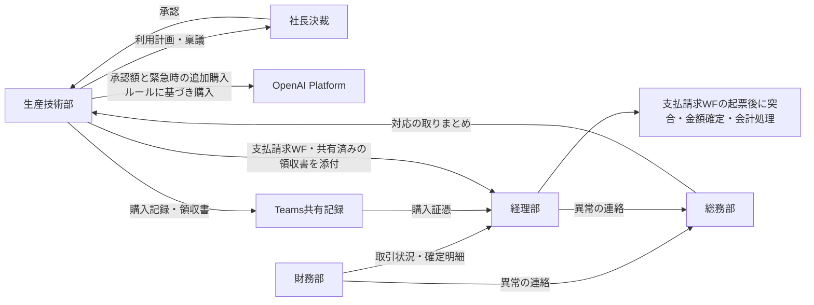
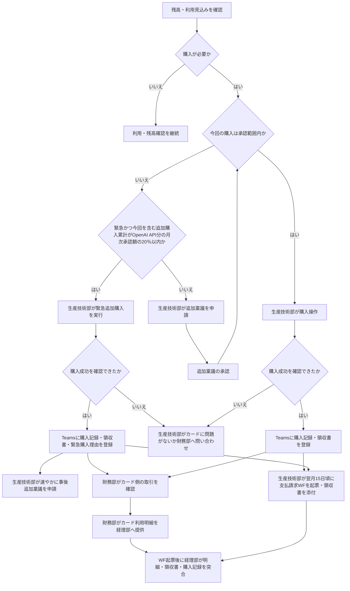

# 生成AIサービス利用料のコーポレートカード決済に関する運用仕様書

## 1. 目的と基本方針

生成AIサービス利用料の個人カードによる立替を解消し、会社管理のコーポレートカードによる決済へ移行する。その際、利用部門である生産技術部に、カード管理・取引確認・会計処理まで集中させず、各部門の権限に応じた役割分担を定める。

生産技術部は、コーポレートカードへの移行自体には賛成する。一方、経理部案のままの運用開始には、業務負担と責任範囲が明確でないため反対する。本書により、開始前に合意すべき要求と運用条件を整理する。

以下を運用の必須条件とする。

- カード情報およびカード会社の管理サイトは財務部が管理し、生産技術部は当該サイトへのログイン・確認作業を行わない。
- 生産技術部は、利用計画、稟議申請、クレジット購入（第5.1節の緊急時の追加購入を含む）、購入証憑の共有、支払請求の起票を担当する。
- カード側の取引確認は財務部、購入記録・証憑との突合および会計処理は経理部が担当する。
- 生産技術部による購入記録は、原則として購入時の一度の登録で完結させ、別台帳への転記を求めない。支払請求WFには、Teamsで共有済みのものと同じOpenAI APIの領収書を添付する。
- 不明な取引を検出でき、担当者不在時にも確認・停止・連絡ができる体制を設ける。

本書の「提案」「案」は未合意事項を示す。カードやサービスの機能、税額、手数料等の契約条件は、運用開始前に確認する。

## 2. 対象範囲と用語

### 2.1 対象サービス

| サービス | 本書で扱う内容 | 決済方法の整理 |
| --- | --- | --- |
| OpenAI API | 月次稟議、クレジット購入、証憑共有、カード明細との突合、支払請求 | コーポレートカードへの移行対象 |
| Azure OpenAI API | 月次稟議の利用予定額・実績の整理 | Lenovo社による既存の請求代行を維持する |
| Claude on AWS | 月次稟議の利用予定額・実績の整理 | KDDIアイレット社による既存の請求代行を維持する |

3サービスを稟議の対象として整理する。Azure OpenAI APIとClaude on AWSは既存の請求代行・支払経路を維持し、今回のコーポレートカードへの移行対象には含めない。OpenAIのクレジット購入手順は、この2サービスには適用しない。将来のカード決済先の追加は、関係部門の協議・承認後に行う。

### 2.2 用語

| 用語 | 意味 |
| --- | --- |
| 利用実績・使用額 | APIの利用により消費した金額。前払クレジットの購入額とは区別する |
| クレジット購入・チャージ | OpenAI Platformで前払残高を購入する行為 |
| 購入額・購入金額 | 領収書に記載された、税等を含むクレジット購入の決済総額 |
| 稟議承認額 | 対象期間と対象費目を定めて社長決裁を受けた上限額 |
| 支払請求 | 社内の支払請求ワークフロー（WF）の起票。生産技術部への立替金精算を意味しない |
| 確定請求額 | カード会社の明細で確定した円貨額。稟議・起票時の見積額と区別する |

## 3. 経理部案に対する主な修正要求

| 論点 | 経理部案の課題 | 本書の要求・修正案 |
| --- | --- | --- |
| カードサイトの確認 | 生産技術部にチャージ後のカードサイト確認を求めている | 財務部が確認し、生産技術部はサービス側の購入証憑を共有する |
| 月次の突合 | 購入実行者である生産技術部にカード明細との突合まで集中している | 経理部が支払請求WFの起票後に突合し、財務部が明細を提供する。生産技術部は差異のうち利用内容に関する照会へ回答する |
| 記録の負担 | 管理台帳・証憑・WFの重複入力範囲が不明 | Teams上の共有記録を購入管理台帳の正本とする。WFには参照先と必要な集計を記載し、Teamsで共有済みのものと同じOpenAI APIの領収書を添付する |
| 月次稟議 | 対象期間、申請期限、承認までの利用可否が不明 | 対象月の開始前に承認する。申請期限と超過時の扱いを定める |
| チャージ方法 | 「必要額」「多額」の基準が不明 | 購入単位・残高の目安・承認上限との関係を数値で定める |
| カード管理・登録 | 財務部による管理と経理部による登録の責任境界が不明 | 財務部をカード管理責任部門とし、その管理下でカードを登録する |
| 不正・異常への対応 | 不正確定までの初動や、不明な取引の確認・停止・連絡の担当が不明 | 疑義の段階で連絡し、財務部・経理部・総務部・生産技術部が必要な確認と対応を分担する |

## 4. 役割と責任

以下は本書で提案する役割分担であり、関係部門の合意により確定する。本書では、カード管理を担う部門を「財務部」と表記する。

| 業務 | 主担当 | 関係部門の役割 |
| --- | --- | --- |
| 利用計画・月次稟議の作成 | 生産技術部 | 社長が決裁。経理部・財務部が換算条件等を提示 |
| カード情報・管理サイトの管理 | 財務部 | カード情報とカード会社の管理サイトを管理する |
| カード登録・更新 | 財務部 | 財務部の管理下で実施し、生産技術部はサービス側の操作に協力 |
| クレジット購入・購入記録の登録 | 生産技術部 | 実行者・代替者を生産技術部長が任命・解任 |
| カード利用通知・取引状況の確認 | 財務部 | 購入記録と照合し、不明な取引は経理部・総務部へ連絡 |
| 支払請求WFの起票・領収書添付 | 生産技術部 | Teamsで共有済みのOpenAI APIの領収書を添付し、経理部が金額・証憑・会計処理を確認 |
| 月次の全取引と証憑の突合 | 経理部 | 支払請求WFの起票後に実施。財務部が明細を提供し、生産技術部は利用内容・購入証憑の照会に回答 |
| 確定請求額への修正 | 経理部 | 財務部が確定明細を提供し、経理部が支払請求WFの金額を修正する |
| 異常時の社内対応の取りまとめ | 総務部 | 財務部がカード会社窓口、生産技術部がサービス側の調査・停止を担当 |

## 5. 運用手順

### 5.1 月次稟議

1. 生産技術部は、サービス別に直近の確定実績と対象月の利用予定額を整理する。
2. **対象月の前月15日までの申請を提案する。** 対象月開始前に社長決裁を完了させる。
3. 見積りの基本値は、直近の確定した1か月の使用額に1.2を乗じた額とする。前月15日時点では前月実績が未確定のため、使用した実績期間を稟議書に明記する。利用拡大等がある場合は、その根拠を加える。
4. 承認上限を超えるクレジット購入は、原則として追加稟議の承認後に実施する。ただし、業務継続のため緊急に購入が必要な場合は、OpenAI API分の月次稟議承認額の20％を上限として追加購入できる。この上限は1回ごとではなく、当該月の緊急追加購入の累計に適用する。生産技術部は、購入理由と金額を記録し、購入後速やかに事後稟議を申請する。

外貨建て購入額の円換算は、次を見積り方法の案とする。

> 円貨見積額 ＝ 税等を含む外貨建て決済予定額 × 稟議に定めたTTMレート × 1.0363

- 1.0363は、経理部案の海外事務処理手数料3.63％を前提とした係数。適用対象・料率は財務部が確認する。
- **申請時にUTPortalで直近（当日もしくは前日）のTTMレートを確認し、利用する**。休業日の扱いは経理部が定める。円貨見積額は、上記の計算後に1円未満を四捨五入する。
- この円換算額は承認・起票用の見積額であり、カード会社の換算方法による確定請求額とは一致しない場合がある。
- 為替・手数料等により、確定請求額が稟議承認額を超過することは許容し、この差額を理由とする追加稟議は不要とする。

### 5.2 カード登録と購入準備

- 財務部の管理下でOpenAI Platformへカードを登録する。
- 生産技術部へカード番号・セキュリティコード・カード管理サイトの認証情報を配布しない。

### 5.3 クレジット購入

購入条件は次の案とする。

| 項目 | 条件案 |
| --- | --- |
| 購入単位 | クレジット500米ドル／回 |
| 決済総額の確認 | 実際の税額・総額は購入画面と証憑で確認する |
| 購入の目安 | 未使用残高がおおむね100米ドルになった時点 |
| 購入前の確認 | 対象期間、承認済み購入上限、購入済み累計、今回購入後の累計を確認する。緊急追加購入の場合は、今回を含む当該月の緊急追加購入の累計がOpenAI API分の月次稟議承認額の20％以内であることも確認する |

### 5.4 購入記録と証憑の共有

生産技術部は、購入後、原則として当日中に、生産技術部・経理部・財務部・総務部が参加するTeamsの共有先へ記録する。投稿と添付証憑を一覧で追跡できる形にし、これを購入管理台帳とする。

| 記録項目 | 内容 |
| --- | --- |
| 購入日時・実行者 | 誰がいつ購入したか |
| 対象サービス・利用目的 | 対象の組織・アカウントと用途 |
| 稟議番号 | 対応する稟議の番号 |
| 購入金額 | 領収書に記載された購入金額 |
| 証憑 | OpenAI APIの領収書の添付または保存先リンク。支払請求WFには、ここで共有したものと同じ領収書を添付する |
| 例外・訂正 | 緊急追加購入、前倒し購入、取消、返金、入力訂正等の理由 |

既存の記録を消して差し替える運用は避け、訂正・取消・返金の経緯を残す。

### 5.5 通知と不明取引の確認

- 生産技術部は、通常業務として日々OpenAI Platformを確認しており、利用状況や残高の変化などから、不正利用の兆候に気付く場合がある。不審な点を把握した場合は、経理部・財務部・総務部へ共有する。この確認も不正利用の早期発見に役立つ可能性があるが、財務部によるカード側の確認および経理部による突合は引き続き実施する。
- OpenAIから `openai_hmqn1b6m@uniontool.co.jp` へ購入通知が届く。通知の受信・閲覧方法を経理部と財務部で確認する。
- サービス側の状態を確認するため、経理部と財務部に、`openai_hmqn1b6m@uniontool.co.jp` を使ったOpenAI Platformへのログインを許可する。
- 財務部はカード会社の利用通知・取引情報を購入記録と照合する。OpenAI側の通知だけでは、他の加盟店での請求は確認できない。

### 5.6 支払請求と月次突合

1. 生産技術部は、支払請求WFを起票する。WFには、請求対象の購入についてTeamsで共有したものと同じOpenAI APIの領収書を添付する。カードサイトの確認や明細全体の突合は担当しない。
2. 起票期限は、購入月の翌月15日頃とする。
3. OpenAI APIの購入金額はドル建てのため、稟議時のTTMレート・手数料率・端数処理を用いて円換算し、起票する。
4. 財務部は、対象期間のカード利用明細を経理部へ提供する。
5. 経理部は、支払請求WFの起票後に、対象カードの全取引とWFに添付された領収書およびTeams上の購入記録・証憑を双方向に突合する。「記録のない請求」と「明細に現れない購入」の両方を確認し、日付・通貨・金額・取消・返金等の差異を整理する。生産技術部は、利用内容や証憑に関する照会へ回答する。
6. 確定後は、経理部が確定請求額へ修正する。

## 6. 異常時の対応

不正の確定を待たず、疑わしい取引・利用を検出した時点で関係部門へ連絡する。停止の要否は、被害拡大と業務影響を踏まえて判断する。

| 事象 | 初動と担当 |
| --- | --- |
| 購入記録のないカード取引、金額不一致 | 財務部・経理部が明細と証憑を確認し、生産技術部へ購入事実を照会する |
| カード情報漏洩・不正請求の疑い | 財務部がカード会社へ連絡し、利用停止・異議申立て等を相談する。総務部が社内対応を取りまとめる |
| 購入失敗・購入成功を確認できない場合 | 生産技術部がカードに問題がないか財務部へ問い合わせる |
